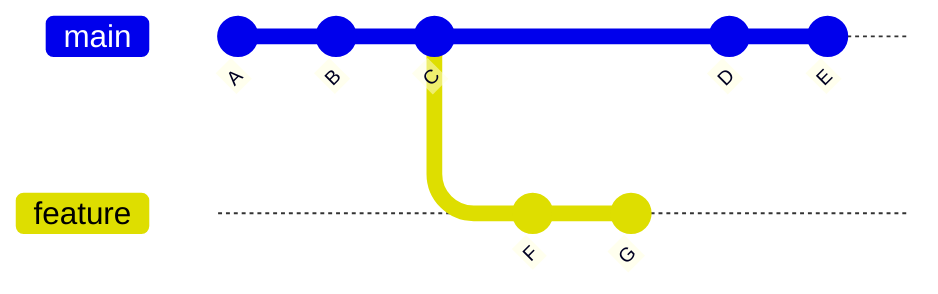
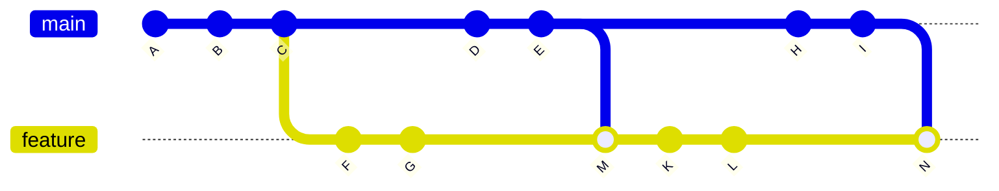
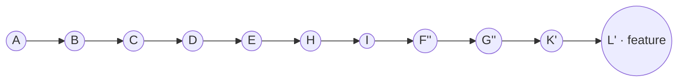

# Git 分支同步主干：merge、rebase 与合入后的历史

本文用同一组提交，说明分支多次同步主干时，提交历史会怎样变化，以及最终合入主干后能否删除分支。

## 1. 起点：主干和分支各自前进

假设 `feature` 从主干的 `C` 创建。随后，主干新增 `D、E`，分支新增 `F、G`：



`D -> E` 与 `F -> G` 是从 `C` 分出的两条提交链。两条链之间没有统一的先后顺序；Git 保存的是提交之间的父子关系，而不是单个线性列表。

## 2. 用 merge 两次同步主干

第一次在 `feature` 上执行 `git merge main`，生成合并提交 `M`。之后主干新增 `H、I`，分支新增 `K、L`。分支再次合并主干，生成 `N`：



`M` 的两个父提交是 `G` 和 `E`；`N` 的两个父提交是 `L` 和 `I`。此时 `main` 指向 `I`，`feature` 指向 `N`。主干上的 `D、E、H、I` 已成为 `feature` 的祖先提交，但主干指针还没有移动。

这不是 `A B C F G D E ...` 或 `A B C D E F G ...` 其中一条固定顺序。`git log` 可以按不同方式展示提交，但不会改变这张有分叉和汇合的图。

### 把 feature 合入 main

如果主干仍指向 `I`，`I` 已经是 `N` 的祖先。普通合并可以**快进**：主干指针从 `I` 移到 `N`，无需复制 `D、E、H、I`，也无需再创建提交。此后两个分支指针都可以指向 `N`。

若使用 `git merge --no-ff feature`，或托管平台选择强制创建合并提交，主干会在 `N` 之后多一个新的合并提交。原有主干提交仍不会重复。若主干在此期间又新增提交，则不能直接快进；需要先重新同步并处理可能的冲突。

> `git push origin feature` 只是推送分支，不会自动修改主干。这里的“合入主干”指在主干上合并分支、将分支直接推到主干引用，或通过平台的合并请求完成合并；实际结果取决于所选合并方式。

## 3. 从一开始改用 rebase 同步

如果第一次同步不用 merge，而是在 `feature` 上运行 `git rebase main`，Git 会把 `F、G` 依次重放到 `E` 后，生成新提交 `F'、G'`；不会产生 `M`。

随后主干新增 `H、I`，分支在 `G'` 后新增 `K、L`。第二次在分支上 rebase 到主干时，会把分支从 `E` 之后的提交依次重放到 `I` 后，生成 `F''、G''、K'、L'`：



此时 `main` 仍指向 `I`。将 `feature` 快进合入主干后，`main` 也指向 `L'`。最终历史是一条直线，没有 `M、N`。撇号表示新提交的 ID：即使代码改动看起来一样，rebase 后的父提交变了，提交 ID 也会变。

如果 `feature` 之前已经推送到远端，rebase 会改写其历史；更新远端分支通常需要 `git push --force-with-lease origin feature`。多人共用的分支应先协调，避免覆盖他人的提交。合入主干本身若是快进，不需要强制推送主干。

## 4. 两种方式如何选择

| 方式 | 同步主干时 | 最终历史 | 已发布分支的影响 |
| --- | --- | --- | --- |
| `merge` | 增加合并提交，保留原提交 ID | 保留分叉与汇合 | 通常可正常推送分支 |
| `rebase` | 把分支提交重放到主干之后，改写提交 ID | 可以形成直线 | 更新已发布分支通常需要 `--force-with-lease` |

两种方式都不会把主干原有的 `D、E、H、I` 复制一份。发生冲突时，merge 和 rebase 都可能需要人工解决；它们主要改变的是提交历史的形状与提交 ID。

## 5. 合入后能删除 feature 吗？

可以，但要先确认主干已经包含分支需要保留的工作。在上面的 merge 示例中，若主干已快进到 `N`，或通过新的合并提交包含了 `N`，删除 `feature` 只会移除分支指针；`F、G、M、K、L、N` 仍可从主干到达，不会因为删除分支而消失。

可先更新远端信息，再检查分支末端是否已成为远端主干的祖先：

```bash
git fetch origin
git merge-base --is-ancestor feature origin/main
```

第二条命令退出码为 `0` 表示已包含。确认后，切换离开 `feature`，再删除本地和远端分支：

```bash
git switch main
git branch -d feature
git push origin --delete feature
```

若使用 **Squash merge**，主干保存的是压缩后的新提交，原 `feature` 提交不一定是主干的祖先；上面的祖先检查可能失败。这时应按合并请求和代码内容确认改动已完整进入主干，再决定是否删除分支。

## 6. 查看真实提交关系

遇到“提交究竟排在哪一边”的疑问，可以查看提交图和分支指针：

```bash
git log --graph --oneline --decorate --all
```

重点看分叉线、合并线和 `main`、`feature` 指向的提交。单纯把日志逐行抄成 `A B C ...`，容易误以为两条并行提交链存在固定的全局顺序。
